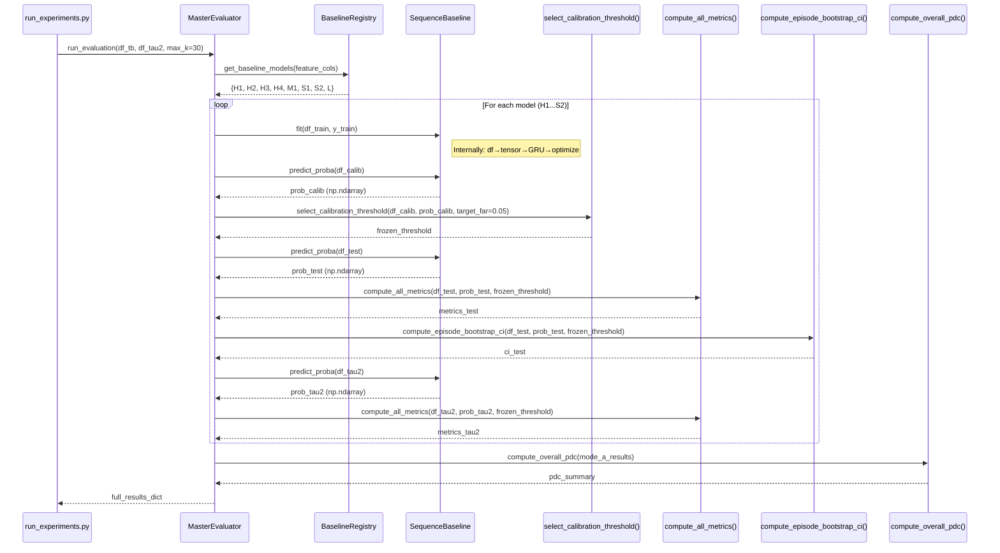

# Gate 4 Architecture V2 — Protocol-Compliant Design

**Date:** 2026-08-04  
**Status:** REDESIGNED — Corrects all 11 violations identified in `gate4_0_1_architecture_reconciliation.md`  
**Design Invariant:** ONE evaluation pipeline. MasterEvaluator is the single evaluation engine. Gate 4 introduces ONLY the Sequence model class and its registration.

---

## 1. Directory Tree

The **only** files added or modified by Gate 4 are marked with `[NEW]` or `[MODIFIED]`:

```
p:\AIRE-TRACE\
├── AGENTS.md
├── AIRE-Trace_Frozen_Protocol_and_Plan.md
├── PRD.md
├── TECHNICAL_DESIGN.md
├── RESEARCH_LOG.md
├── configs/
│   └── data.yaml
├── data/
│   └── processed/manifests/
│       ├── terminalbench_prefixes.parquet
│       ├── tau2_prefixes.parquet
│       └── dataset_manifest.json
├── src/
│   ├── baselines/
│   │   ├── __init__.py
│   │   ├── heuristics.py                    # H1, H2, H3, H4 — UNCHANGED
│   │   ├── logistic.py                      # M1 — UNCHANGED
│   │   ├── random_forest.py                 # S1 (tabular RF baseline) — UNCHANGED
│   │   ├── sequence.py                      # [NEW] S2 — GRU/1D-CNN Sequence model
│   │   └── registry.py                      # [MODIFIED] Add S2 to registration
│   ├── evaluation/
│   │   ├── __init__.py
│   │   ├── evaluator.py                     # MasterEvaluator — UNCHANGED
│   │   ├── thresholding.py                  # Threshold calibration — UNCHANGED
│   │   ├── metrics.py                       # Metric computation — UNCHANGED
│   │   ├── bootstrap.py                     # Episode-cluster bootstrap — UNCHANGED
│   │   └── pdc.py                           # PDC — UNCHANGED
│   ├── preprocessing/
│   │   ├── normalizer.py                    # UNCHANGED
│   │   ├── prefix_generator.py              # UNCHANGED
│   │   ├── sanitization.py                  # UNCHANGED
│   │   └── splitter.py                      # UNCHANGED
│   ├── schemas/
│   │   └── canonical.py                     # UNCHANGED
│   ├── leakage/
│   │   └── validators.py                    # UNCHANGED
│   └── run_gate3_experiments.py             # UNCHANGED (Gate 5 creates a new runner)
├── results/
│   └── baseline_runs/                       # UNCHANGED — frozen Gate 3 artifacts
├── reports/
│   └── ...                                  # UNCHANGED
├── tests/
│   ├── baselines/
│   │   └── test_sequence.py                 # [NEW] Unit tests for S2
│   └── ...                                  # UNCHANGED
└── docs/
    └── ...                                  # UNCHANGED
```

### What is NOT created by Gate 4:

- ❌ No `src/aire_trace/` package
- ❌ No `encoder.py`, `temporal_model.py`, `prediction_head.py`
- ❌ No `confidence.py`, `inference.py`, `trainer.py`
- ❌ No `feature_fusion.py`, `utils.py`
- ❌ No separate `registry.py`
- ❌ No `AbstractMonitor` base class
- ❌ No new evaluation pipeline

---

## 2. Class Diagram

```mermaid
classDiagram
    class MasterEvaluator {
        +target_far: float
        +bootstrap_iterations: int
        +random_seed: int
        +run_evaluation(df_tb, df_tau2, max_k) Dict
    }

    class BaselineRegistry {
        +get_baseline_models(feature_cols) Dict
    }

    class HeuristicMonitor {
        +model_id: str
        +target_feature: str
        +fit(df, y)
        +predict_proba(df) ndarray
    }

    class CombinedHeuristicMonitor {
        +model_id: str
        +fit(df, y)
        +predict_proba(df) ndarray
    }

    class LogisticBaseline {
        +model_id: str
        +feature_cols: List
        +fit(df, y, sample_weight)
        +predict_proba(df) ndarray
    }

    class RandomForestBaseline {
        +model_id: str
        +feature_cols: List
        +fit(df, y, sample_weight)
        +predict_proba(df) ndarray
    }

    class SequenceBaseline {
        +model_id: str
        +feature_cols: List
        +hidden_dim: int
        +num_layers: int
        +max_seq_len: int
        +device: str
        +fit(df, y, sample_weight)
        +predict_proba(df) ndarray
    }

    BaselineRegistry --> HeuristicMonitor : creates H1,H2,H3
    BaselineRegistry --> CombinedHeuristicMonitor : creates H4
    BaselineRegistry --> LogisticBaseline : creates M1
    BaselineRegistry --> RandomForestBaseline : creates S1
    BaselineRegistry --> SequenceBaseline : creates S2

    MasterEvaluator --> BaselineRegistry : get_baseline_models()
    MasterEvaluator --> "select_calibration_threshold()" : calibrates
    MasterEvaluator --> "compute_all_metrics()" : evaluates
    MasterEvaluator --> "compute_episode_bootstrap_ci()" : bootstrap
    MasterEvaluator --> "compute_overall_pdc()" : ranking stability
```

### Key Design Principle

`SequenceBaseline` has **exactly the same external interface** as `LogisticBaseline` and `RandomForestBaseline`:

| Method | Signature | Purpose |
|---|---|---|
| `fit()` | `fit(df_train: pd.DataFrame, y_train: np.ndarray, sample_weight: np.ndarray = None)` | Train the model on TRAIN data |
| `predict_proba()` | `predict_proba(df: pd.DataFrame) -> np.ndarray` | Return failure probabilities [0, 1] |

Internal sequence processing (DataFrame → padded tensor → GRU → probability) is **entirely private** to the class. `MasterEvaluator` never sees PyTorch tensors, sequence padding, or hidden states.

---

## 3. Execution Flow



### Critical Invariants Preserved

1. **Same call sequence for every model:** `fit()` → `predict_proba(calib)` → `select_calibration_threshold()` → `predict_proba(test)` → `compute_all_metrics()` → bootstrap → `predict_proba(tau2)` → `compute_all_metrics()`
2. **Same code path for threshold calibration:** `select_calibration_threshold()` from `src/evaluation/thresholding.py`
3. **Same code path for metrics:** `compute_all_metrics()` from `src/evaluation/metrics.py`
4. **Same code path for bootstrap:** `compute_episode_bootstrap_ci()` from `src/evaluation/bootstrap.py`
5. **Same code path for PDC:** `compute_overall_pdc()` from `src/evaluation/pdc.py`

---

## 4. Call Graph

```
run_experiments.py
  └── MasterEvaluator.run_evaluation()
        ├── BaselineRegistry.get_baseline_models()
        │     ├── HeuristicMonitor("H1")         # EXISTING — unchanged
        │     ├── HeuristicMonitor("H2")         # EXISTING — unchanged
        │     ├── HeuristicMonitor("H3")         # EXISTING — unchanged
        │     ├── CombinedHeuristicMonitor("H4") # EXISTING — unchanged
        │     ├── LogisticBaseline("M1")          # EXISTING — unchanged
        │     ├── RandomForestBaseline("S1")      # EXISTING — unchanged
        │     ├── SequenceBaseline("S2")          # [NEW] — Gate 4 addition
        │     └── "L_PENDING"                     # EXISTING — unchanged
        │
        ├── For each model:
        │     ├── model.fit(df_train, y_train)
        │     │     └── [S2 internal: _prepare_sequences() → GRU.forward() → loss.backward()]
        │     ├── model.predict_proba(df_calib)
        │     │     └── [S2 internal: _prepare_sequences() → GRU.forward() → sigmoid]
        │     ├── select_calibration_threshold()              # src/evaluation/thresholding.py
        │     ├── model.predict_proba(df_test)
        │     ├── compute_all_metrics()                       # src/evaluation/metrics.py
        │     ├── compute_episode_bootstrap_ci()              # src/evaluation/bootstrap.py
        │     ├── model.predict_proba(df_tau2)
        │     └── compute_all_metrics()                       # src/evaluation/metrics.py
        │
        └── compute_overall_pdc()                             # src/evaluation/pdc.py
```

---

## 5. Data Flow

```
┌─────────────────────────────────────────────────────────┐
│                 DATA LAYER (unchanged)                    │
│                                                           │
│  terminalbench_prefixes.parquet ──┐                      │
│  tau2_prefixes.parquet ───────────┤                      │
│                                    ▼                     │
│                           pd.DataFrame                    │
│                    (episode_id, prefix_len,               │
│                     split, eventual_outcome,              │
│                     feat_* columns)                       │
└────────────────────────┬────────────────────────────────┘
                          │
                          ▼
┌─────────────────────────────────────────────────────────┐
│              MODEL LAYER                                  │
│                                                           │
│  ┌──────────┐ ┌──────────┐ ┌──────────┐ ┌────────────┐ │
│  │ H1-H4    │ │ M1       │ │ S1 (RF)  │ │ S2 (GRU)   │ │
│  │ Heuristic│ │ LogReg   │ │ TabularML│ │ [NEW]      │ │
│  └────┬─────┘ └────┬─────┘ └────┬─────┘ └─────┬──────┘ │
│       │             │            │              │        │
│       │   All models expose identical interface:         │
│       │   fit(df, y) → None                              │
│       │   predict_proba(df) → np.ndarray                 │
│       │                                                   │
│       │   S2 internal only:                               │
│       │   df → _extract_features() → _pad_sequences()   │
│       │   → torch.Tensor → GRU → sigmoid → np.ndarray   │
│       │                                                   │
└───────┴────────────┬────────────────────────────────────┘
                      │
                      │  np.ndarray (probabilities)
                      ▼
┌─────────────────────────────────────────────────────────┐
│           EVALUATION LAYER (100% unchanged)              │
│                                                           │
│  MasterEvaluator.run_evaluation()                        │
│    ├── select_calibration_threshold()  → frozen_thresh   │
│    ├── compute_all_metrics()           → metric dict     │
│    ├── compute_episode_bootstrap_ci()  → CI dict         │
│    └── compute_overall_pdc()           → PDC summary     │
│                                                           │
└────────────────────────┬────────────────────────────────┘
                          │
                          ▼
┌─────────────────────────────────────────────────────────┐
│           OUTPUT LAYER (unchanged)                        │
│                                                           │
│  results/baseline_runs/                                   │
│    ├── primary_k30_results.json                          │
│    ├── baseline_comparison_table.csv                     │
│    ├── calibrated_thresholds.json                        │
│    ├── pdc_summary.json                                  │
│    └── sensitivity_k_results.json                        │
│                                                           │
└─────────────────────────────────────────────────────────┘
```

---

## 6. SequenceBaseline Internal Architecture (Private to the Class)

```
SequenceBaseline.fit(df_train, y_train, sample_weight)
│
├── 1. _extract_feature_matrix(df_train) → np.ndarray [N × F]
│       Selects feat_* columns, identical to LogisticBaseline/RandomForestBaseline
│
├── 2. _group_by_episode(features, df_train) → Dict[episode_id → List[feature_vectors]]
│       Groups prefix rows by episode_id, orders by prefix_len
│
├── 3. _pad_sequences(episode_sequences, max_len=K) → torch.Tensor [B × K × F]
│       Pads variable-length sequences to max_seq_len, creates attention mask
│
├── 4. _build_model() → torch.nn.Module
│       GRU(input_dim=F, hidden_dim=H, num_layers=L) + Linear(H, 1) + Sigmoid
│       OR
│       Conv1d(in_channels=F, ...) + AdaptivePool + Linear + Sigmoid
│
├── 5. Training loop (encapsulated)
│       For each epoch:
│         For each batch of episodes:
│           forward pass → BCE loss (weighted by sample_weight)
│           loss.backward() → optimizer.step()
│
└── 6. self.is_fitted = True


SequenceBaseline.predict_proba(df)
│
├── 1. _extract_feature_matrix(df) → np.ndarray [N × F]
├── 2. _group_by_episode(features, df) → episode sequences
├── 3. _pad_sequences(sequences) → torch.Tensor [B × K × F]
├── 4. model.forward(padded_sequences) → torch.Tensor [B, 1]
├── 5. Expand episode-level predictions back to prefix-level
│       Each prefix within an episode gets the prediction at its specific timestep
└── 6. Return np.ndarray [N] clipped to [0, 1]
```

### Critical Detail: Prefix-Level vs Episode-Level Prediction

`MasterEvaluator` passes a DataFrame of individual prefix rows (each row = one checkpoint of one episode). The existing models (H/M/S1) predict independently per prefix row.

`SequenceBaseline` must also return one probability per prefix row. Internally, it groups prefixes by episode, processes the sequence up to each checkpoint `t`, and returns `P(failure | e_1...e_t)` for each prefix row. The output `np.ndarray` has the same length as the input DataFrame — `MasterEvaluator` never needs to know that sequences were involved.

---

## 7. Gate 4 Scope (Strictly Bounded)

### In Scope

| Deliverable | Location |
|---|---|
| Sequence model class | `src/baselines/sequence.py` [NEW] |
| Registration in registry | `src/baselines/registry.py` [MODIFIED — add `"S2": SequenceBaseline(...)` to dict] |
| Unit tests | `tests/baselines/test_sequence.py` [NEW] |

### Explicitly Out of Scope (Deferred to Later Gates)

| Item | Assigned Gate |
|---|---|
| Running full evaluation with S2 | Gate 5 |
| Threshold calibration for S2 | Gate 5 (via unchanged `MasterEvaluator`) |
| Bootstrap CIs for S2 | Gate 5 (via unchanged `MasterEvaluator`) |
| PDC with S2 included | Gate 5 (via unchanged `MasterEvaluator`) |
| Metric sensitivity / ablation | Gate 7 |
| Final comparison tables | Gate 9 |
| New `AbstractMonitor` base class | NOT BUILT — unnecessary; existing duck-typing interface is sufficient |
| `src/aire_trace/` package | NOT BUILT — violates frozen architecture |
| `confidence.py`, `inference.py`, `trainer.py` | NOT BUILT — duplicates evaluation pipeline |

---

## 8. Verification Against Reconciliation Violations

| Violation ID | Description | Resolution in V2 |
|---|---|---|
| V-1 | Second calibration pipeline | ✅ Eliminated — `confidence.py` not created |
| V-2 | Second inference pipeline | ✅ Eliminated — `inference.py` not created |
| V-3 | Duplicate threshold calibration | ✅ Eliminated — single path through `thresholding.py` |
| V-4 | Duplicate evaluation orchestration | ✅ Eliminated — single `MasterEvaluator` |
| V-5 | Duplicate metrics via `evaluate()` | ✅ Eliminated — no `evaluate()` method |
| V-6 | Implicit duplicate reporting | ✅ Eliminated — reporting deferred to Gate 5/9 |
| V-7 | Standalone `src/aire_trace/` framework | ✅ Eliminated — model in `src/baselines/sequence.py` |
| V-8 | Duplicate registry | ✅ Eliminated — extends existing `BaselineRegistry` |
| V-9 | Interface mismatch | ✅ Eliminated — matches `fit(df, y)` / `predict_proba(df)` |
| V-10 | Code-path divergence | ✅ Eliminated — single evaluation code path |
| V-11 | Self-reported metrics | ✅ Eliminated — no `evaluate()` method |
| V-12 | Roadmap scope creep | ✅ Eliminated — Gate 4 is model implementation only |

**All 11 violations resolved. Zero new evaluation infrastructure introduced.**

---

*No code was written. No implementation was performed. This document defines architecture only.*
